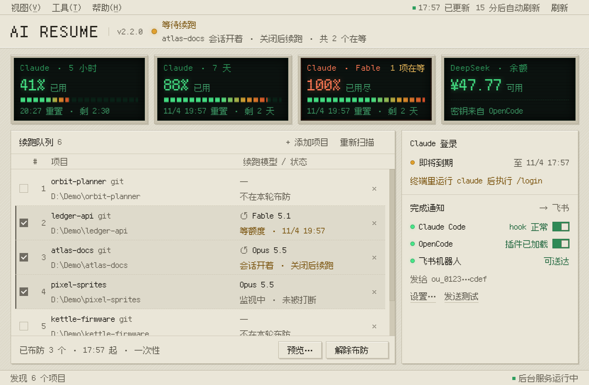
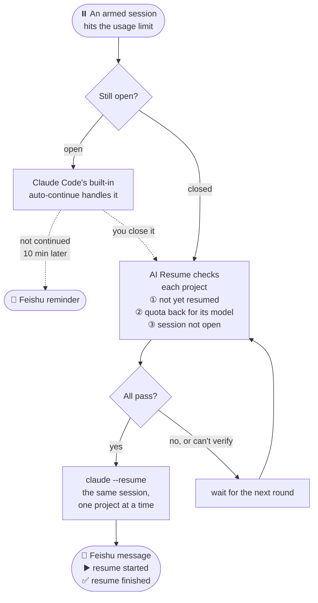

<div align="center">

# AI Resume

**Hit a Claude Code usage limit? Go to bed.**

When the quota comes back, AI Resume picks up the sessions you already closed, right where they stopped;<br>
when a task finishes, fails or needs your call, it messages you on Feishu.

[](#requirements)
[](https://dotnet.microsoft.com/)
[](csharp/Directory.Build.props)
[](LICENSE)

**English** · [简体中文](README.zh-CN.md)

</div>



<p align="center"><sub>Demo data: three armed (guarded) projects. One is waiting for the Fable weekly limit, one has its session still open and resumes once it's closed, one wasn't interrupted and is just being watched. The amber on the right is the panel being honest: the Claude login expires within 3 days. The interface and the notifications are in Simplified Chinese.</sub></p>

## Why

Claude Code's built-in auto-continue (`autoContinueAtUsageLimit`, on by default since 2.1.234; the Desktop app has its own switch) only looks after interactive sessions that are **still open**. Close the session and the process exits, taking the wait with it; a Remote Control session on your phone (手机远程 in the interface and messages), or a weekly limit that won't reset for more than a day, isn't waited for either. Leave a long task running overnight, hit the limit, and in the morning you often find a session stopped halfway.

That gap is what AI Resume fills. The two split the work and never step on each other:

| Situation | Claude Code's built-in auto-continue | AI Resume (armed projects) |
|---|---|---|
| Session still open (terminal, Desktop, VS Code) | Waits in place and continues after the reset | Stays out of it; if the session still hasn't continued 10 minutes after the quota is back, you get one Feishu reminder |
| Session already closed | Nothing (the process exited, and the wait with it) | Once the quota has really recovered, resumes the same session with `claude --resume` |
| Remote Control session on your phone | Doesn't wait | Stays out of it while it's open; if it still hasn't continued 10 minutes after the quota is back, reminds you to continue from the phone |
| Weekly limit that won't reset for more than a day | Doesn't wait | A closed session waits as long as it takes, then resumes |

> [!NOTE]
> An unattended night has two preconditions. First, the PC must not sleep: AI Resume runs locally and does nothing while it's asleep. Second, someone has to keep the login token fresh: AI Resume never refreshes tokens, the access token expires after about 8 hours, and only a running Claude Code renews it. With every Claude Code closed, resuming waits once the token expires, until you open Claude Code again; to be safe, keep one Claude Code process running, for example `claude remote-control` in another folder.

## What it does

### Resumes after a usage limit

- **Real quota, not a timer.** Readings come from Anthropic's official OAuth usage endpoint, using Claude Code's own login. A project goes ahead only when this round's live reading shows its limits below full.
- **Per project, each with its own model.** Every project looks only at the limits that apply to its model: a full Fable weekly limit doesn't hold back a project on Opus.
- **The same session, not a new one.** It runs `claude --resume <session-id>`, so the context is intact: no new session, no rewritten transcript. Each interruption is resumed at most once.
- **When in doubt, it waits.** Session just opened, token about to expire, configuration just changed: that project waits for the next round. If something goes wrong after the resume process has started, the round stops for you to check, and it won't resume that project on its own again.

### Feishu messages: finished, failed or waiting for you

- Three kinds of events from Claude Code and OpenCode: finished, stopped by an error, and waiting for you (permission, confirmation, input).
- When a usage limit hits, each session is reported once per limit window; sessions cut off together share one message, which says whether AI Resume will resume them, based on what's armed when it's sent.
- Sent by your own Feishu bot through the official lark-cli. A failed message only delays itself; a problem that affects every message (a rejected credential, no network, Feishu rate limiting) pauses Feishu delivery for a while, then it retries on its own.

A message looks like this (synthetic example, in the Chinese you actually receive):

```text
⏸️ atlas-docs 被用量上限打断
Claude Code · Opus 5.5 · 02:14 · 「迁移文档站」
5 小时额度已用完,预计 04:30 重置
已布防:额度恢复后 AI Resume 会续跑它;会话还开着的话 AI Resume 不插手,关掉后才续
```

It reads: *atlas-docs was cut off by the usage limit · source, model, time and session name · the 5-hour limit is used up and resets at 04:30 · armed: AI Resume will resume it once the quota is back; while the session is open it stays out of the way, and resumes after you close it.* Once the quota is back and the session is closed, **▶️ atlas-docs 已开始自动续跑** (resume started) and **✅ atlas-docs 自动续跑完成** (resume finished) follow.

### Checks the budget before spawning subagents (shadow mode by default)

- A small mod runs inside Claude Code: before each subagent or workflow agent starts, it weighs the current 5-hour and weekly readings and the remaining cost of agents already running, counting only up to the next reset, and decides whether this one fits.
- After install it runs in **shadow mode**: everything still starts, and it only records what it *would* have done. The **子代理预检** (subagent budget check) block on the right and **视图 › 子代理预检…** show each decision, predicted vs. actual cost (p80 coverage) and the mod's readings next to the OAuth ones.
- Once you have seen the evidence you can turn on **启用拦截** (enforce) yourself: agents that don't fit are deferred and you are reminded to re-dispatch after the reset; near the limit, running subagents wrap up with what they have. No pop-ups, no cap on the number of subagents.
- Choosing **已关闭** (off) removes that entry from `settings.json`, so new sessions no longer load the mod. If your organization's managed Claude Code policy forbids side-loaded mods, AI Resume does not register it at all (otherwise every Claude Code session would exit at start) and the panel says why.

### A control panel that tells the truth

- **Quota tiles**: Claude 5-hour, 7-day and per-model weekly limits, plus the balance of the DeepSeek account OpenCode uses.
- **Resume queue**: projects are discovered from Claude Code's session history, so there's no list to maintain; you can also **+ 添加项目** (add a project) or move folders you don't care about into **不再扫描的目录** (no longer scanned). Each project's model and what it is waiting for, at a glance; **预览…** (Preview) shows every verdict without running anything.
- **Claude login**: how long the login has left, with Feishu reminders to `/login` starting 3 days before it expires.
- **Green needs evidence.** An installed CLI or a filled-in key doesn't count: a provider needs a real request that succeeded, Feishu needs a real delivery, and **hook 正常** (hook OK) means the program the hook points to really exists. Anything that can't be checked says **未核实** (unverified) or **待核实** (pending check), never "all good".

## How it works



Notifications take a separate path: Claude Code's hooks and OpenCode's plugin write events to a local queue, and the background service delivers them to Feishu through lark-cli. The interface, queue and state all stay on your machine; AI Resume has no cloud service. For the mechanics, see the [architecture](docs/ARCHITECTURE.md); the detailed documents are written in Chinese.

## Requirements

| Needs | Notes |
|---|---|
| Windows 10 / 11 | The interface runs on WebView2: built into Windows 11; on Windows 10, install the [WebView2 Runtime](https://developer.microsoft.com/microsoft-edge/webview2/) if it's missing |
| [.NET 10 SDK](https://dotnet.microsoft.com/download) | Built from source for now |
| [Claude Code](https://claude.com/claude-code) 2.1.139 or newer | `claude.exe` on `PATH`, logged in with your Claude account |
| Node.js and the official [lark-cli](https://github.com/larksuite/cli) | For Feishu notifications: `npm i -g @larksuite/cli` (verified against 1.0.81), plus a Feishu custom app with its bot enabled. Feishu only for now; Lark (the international edition) isn't supported |

Optional: OpenCode 2.x for its notifications and DeepSeek balance; Codex CLI for Codex quota and resume (hidden by default).

## Install

```powershell
git clone https://github.com/AquariusCZ/claude-resume.git
cd claude-resume
dotnet build csharp\AiResume.sln -c Release
csharp\src\AiResume.Worker\bin\Release\net10.0-windows\AiResume.Worker.exe install
```

`install` deploys to `%LOCALAPPDATA%\AI Resume\`, creates the Desktop, Start-menu and logon entries (the autostart opens no console window), and re-points the notification sources you had turned on at the installed copy; a first install turns none on, see Quick start below. Only exit code 0 means everything is in place: 2 means some notification sources weren't set up, 3 that the new background service did not come up (the previous version was restored), 4 that the rollback was incomplete (the recovery material is left in place; don't delete it yet).

What runs is the installed copy, so re-run `install` after every rebuild, then close the old window and reopen it.

To have the background service restarted if it ever dies, switch the autostart to a scheduled task: from an elevated PowerShell in the repository root, run `powershell -ExecutionPolicy Bypass -File .\scripts\register-autostart.ps1`; add `-Revert` to switch back (see [logon autostart](docs/ARCHITECTURE.md#logon-autostart)). Known issue: run this way, the background service lives in session 0 and the interface can't reach it yet, so the footer and the **飞书机器人** (Feishu bot) row say 未核实 (unverified); delivery and resuming are unaffected.

Uninstalling removes the program, the shortcuts and AI Resume's own hook entries. Your settings, run history and Feishu bot credential in `%LOCALAPPDATA%\AI Resume\state\` are kept for the next install. If you registered the scheduled task, remove it with `-Revert` first.

```powershell
& "$env:LOCALAPPDATA\AI Resume\AiResume.Worker.exe" uninstall
```

## Quick start

1. **Check the Claude login.** Open **AI Resume** from the Desktop or Start menu. **Claude 登录** (Claude login) on the right should read **有效** (valid). It uses Claude Code's own login, so there's nothing to fill in.
2. **Turn on notification sources.** Under **完成通知 → 飞书** (completion notifications → Feishu) on the right, switch on Claude Code (and OpenCode if you use it) until it reads **hook 正常** (hook OK). OpenCode shows **插件已加载** (plugin loaded) instead; if it stays at 待核实, restart OpenCode once.
3. **Connect Feishu** (optional, but worth it):
   - In the Feishu developer console, create a custom app with the bot capability and permission to send messages, publish a version so the bot is enabled, and make sure you are within the app's availability.
   - Open **工具 › 飞书通知设置…** (Tools › Feishu notification settings), enter the App ID (`cli_…`) and App Secret, and press **保存并验证** (save and verify).
   - Recipient: press **识别** (detect) to pick yourself from the users logged in to lark-cli (if the list is empty, run `lark-cli auth login` for this app first), or paste your `ou_…` open_id and press **保存** (save). An open_id belongs to one app, so it must come from the bot's own app.
   - Close the dialog and press **发送测试** (send test) on the right. **🧪 AI Resume 测试通知** should arrive on your phone. If it doesn't, press **诊断通道** (diagnose) in the dialog, or run `notify check` below.
4. **Arm**, that is, hand projects over to AI Resume. Tick the projects to guard in the resume queue. Each one follows the model its session last used (**沿用会话**) unless you pick another. Press **预览…** to see each project's current verdict, then **布防** (Arm). Arming pins each project to its most recent session at that moment, so arm after the work has started; a session you start in that project later isn't covered until you disarm and arm again. Arming is one-shot by default and disarms once every project is done; to resume after every interruption, turn on **工具 › 连续模式** (Tools › Continuous mode), which applies from the next arm.

To double-check the setup:

```powershell
$w = "$env:LOCALAPPDATA\AI Resume\AiResume.Worker.exe"
& $w notify list    # sources you turned on show 已启用 (enabled) and 可送达 (deliverable) True, exit code 0
& $w notify check   # last line: 结论: 飞书通知通道就绪 (channel ready)
& $w notify test    # really delivered within 90 seconds, exit code 0
```

When the panel footer reads **后台服务运行中** (background service running), **Claude 登录** reads **有效**, the Claude Code row reads **hook 正常** and **飞书机器人** reads **可送达**, you're all set.

## Security and privacy

- **It won't log you out.** AI Resume holds no Claude credential of its own. It only reads Claude Code's login file (`%USERPROFILE%\.claude\.credentials.json`, or the same file under `CLAUDE_CONFIG_DIR`) and **never refreshes or writes back an OAuth token**. The refresh token can be used only once, so one refresh by any other program logs Claude Code out. The running Claude Code rotates its own tokens; the login lasts about 30 days, and only your own `/login` renews it.
- **Other tools' credentials are read-only.** Codex's `auth.json` and OpenCode's DeepSeek key are read, never written; AI Resume stores no DeepSeek key.
- **Feishu bot credential: verified before it's saved, locked down once it is.** The App ID and App Secret only come in through **飞书通知设置**. Before saving, AI Resume really exchanges them with Feishu for a tenant_access_token, then uses that token to call the bot info endpoint once through lark-cli; only when both succeed is the pair encrypted with Windows DPAPI (machine scope) into `state\secrets\feishu-bot.bin`. Only you, SYSTEM and Administrators can access the file; if that can't be guaranteed, nothing is saved. Machine scope means an administrator on this PC can decrypt it. At delivery the App Secret only appears in the request to Feishu's token endpoint, and lark-cli receives just the App ID and a short-lived token, which stays in memory. Credentials never reach the command line, logs, the interface or screenshots; the interface only shows a masked App ID. Uninstalling keeps the credential; to remove it, press **清除凭据** (clear credential) in **飞书通知设置**.
- **No cloud service, no telemetry.** Outbound requests are of three kinds: quota and model-catalog queries made with the credentials your clients already have (Anthropic, and any API endpoint you configured for Claude Code; with Codex or OpenCode installed, also OpenAI, DeepSeek and any third-party provider configured in Codex); the bot-token exchange with Feishu's official endpoint; and Feishu messages and channel diagnostics through lark-cli. Refreshing the panel calls no model and spends no tokens. Tokens and credentials never go into logs, and notification logs don't record message text.
- **The budget mod never touches credentials.** It only uses the usage readings Claude Code itself reports and never reads, writes or refreshes a token; its logs hold token counts, readings and decisions, never prompt text. `install` adds a single path to `env.CLAUDE_CODE_PLUGIN_DIRS` in `~/.claude/settings.json` and `uninstall` removes that one entry.

## FAQ

<details>
<summary><b>Doesn't Claude Code already continue on its own?</b></summary>

It does, but only for interactive sessions that are still open, and it doesn't wait for Remote Control sessions or weekly limits that won't reset for more than a day. AI Resume only resumes closed sessions. It never touches an open one (Remote Control included); for an armed project, if the session still hasn't continued 10 minutes after the quota is back, it sends one Feishu reminder, so you can carry on yourself or close the session and hand it over. See the [table above](#why).

</details>

<details>
<summary><b>Will it log my Claude Code out?</b></summary>

No. AI Resume only reads Claude Code's login file. It never refreshes or writes back a token.

</details>

<details>
<summary><b>Will resuming quietly eat my quota?</b></summary>

Resuming continues your original session on your subscription, exactly as if you came back and typed `continue`, and each interruption is resumed at most once. Beyond that, AI Resume calls no model: refreshing the panel only reads the quota and model-catalog endpoints, at zero tokens.

</details>

<details>
<summary><b>What happens when a resume fails?</b></summary>

It depends on when. Anything that stops a resume before it starts (session just opened, token about to expire, configuration just changed) only skips this round, and the next round judges again. If something goes wrong after the resume process has started, the round stops and that project isn't resumed on its own again until you check, disarm and arm again. A project that hits the limit again right after resuming goes back to waiting instead of hogging the queue.

</details>

<details>
<summary><b>What if the resumed run needs a permission approval?</b></summary>

Nobody is there to approve it. The resume runs unattended in the background (`claude -p`) with your own Claude Code permission settings; AI Resume neither raises nor lowers them, so anything that needs on-the-spot approval can't be approved. For long unattended runs, allow what the task needs in Claude Code's permission settings beforehand. Open the session afterwards to see what it did.

</details>

<details>
<summary><b>Can I use it without Feishu?</b></summary>

Yes. Resuming doesn't depend on Feishu; without it you just don't get the completion notifications, the resume notices and the login-expiry reminders.

</details>

<details>
<summary><b>How do I keep working from my phone?</b></summary>

Use Claude Code's official [Remote Control](https://code.claude.com/docs/en/remote-control) (`claude remote-control`). It needs a Claude subscription login, and the local `claude` process has to keep running, which also keeps the login token renewed. The session still runs on this machine, so hooks fire and notifications go out as usual. While a Remote Control session is open, AI Resume stays out of it, and Claude Code doesn't auto-continue it after a limit either; for an armed project, the Feishu reminder 10 minutes after the quota is back is your cue to continue from the phone. AI Resume itself is not a chat bot.

</details>

<details>
<summary><b>What about Codex, OpenCode, Cline and Qoder?</b></summary>

- **OpenCode 2.x**: completion notifications, plus the balance of the DeepSeek account it uses (display only, never used to resume).
- **Codex**: hidden by default. **视图 › 显示 Codex** (View › Show Codex) adds its quota tile and offers it as the resume provider. It uses your official ChatGPT/OpenAI login from `%USERPROFILE%\.codex\auth.json`. Resuming requires exactly Codex 0.148.0 and a `managed_config.toml` in the Codex configuration folder, both checked when you arm. Codex's session records carry no structured rate-limit evidence, so a project is queued when its model is observed limited, and resumes when every account window is below 100%.
- **Codex, Cline and Qoder completion notifications**: "finished" only, hidden by default; turn them on under **视图 › 显示其他通知源** (View › Show other notification sources). Codex needs you to trust the hook once with `/hooks` inside Codex, and only new sessions pick it up.
- When quota can't be verified, it waits; it never switches providers to rerun.

</details>

<details>
<summary><b>Does it run on macOS or Linux?</b></summary>

No. It relies on a WPF + WebView2 interface, Windows DPAPI and scheduled tasks, and supports Windows 10/11 only.

</details>

<details>
<summary><b>Why do I see 未核实 and 待核实 so often?</b></summary>

On purpose. Every positive conclusion, such as "OK" or "deliverable", needs outside evidence: quota needs this round's live reading; **可送达** (deliverable) needs the latest real delivery, with no settings changed since; **hook 正常** (hook OK) means the program the hook points to really exists; OpenCode's **插件已加载** (plugin loaded) trusts only OpenCode's own log. What can't be checked is said plainly, never painted green.

</details>

<details>
<summary><b>Is it stable?</b></summary>

The core decisions are covered by more than 1,300 automated tests across the repository, all on synthetic sessions and temporary folders, never a real session. Installation and Feishu delivery have been verified on the author's machine, including the background service running as a scheduled task in session 0. Still waiting on real-world events: an end-to-end automatic resume after a real usage limit, a real OpenCode task completion notification, and the Claude Code login-expiry reminders. Verification records: [Completion notifications · verification](docs/COMPLETION-NOTIFICATIONS.md#6-验证层级).

</details>

## Reference

<details>
<summary><b>Claude login states</b></summary>

The access token rotates about every 8 hours, and Claude Code renews it whenever it runs (a terminal, Desktop or VS Code session, or a connected Remote Control). The login behind it lasts about 30 days, and only `/login` renews it. A resume run starts only while the access token has at least 45 minutes left; otherwise that project waits for Claude Code to renew it.

| Panel | Meaning | What to do |
|---|---|---|
| **有效** | Logged in, access token valid | — |
| **有效 · 账号未核实** | No consistent account record yet; resume waits | Open Claude Code once so it writes the account record |
| **令牌待续期** | Access token expired, login still valid | Open Claude Code once, or keep Remote Control connected |
| **即将到期** | Login expires within 3 days | Run `claude`, then `/login` |
| **已过期** / **未登录** | Login expired or cleared, or no login at all | Run `claude`, then `/login` |
| **被服务端拒绝** | The quota endpoint rejected this machine's login (password changed, removed from the organization, or logged out elsewhere) | Run `claude`, then `/login` |
| **凭据位置变化** | Claude Code moved its login into Windows Credential Manager, which AI Resume cannot read | Quota stays unverified and resume keeps waiting |
| **未核实** | The login file exists but couldn't be read this time (most likely Claude Code was rewriting it) | Nothing; it's re-read shortly |

With a Feishu recipient set, the background service reminds you 3 days, 2 days, 1 day and 12 hours before the login expires, and once more when it has; if Claude Code clears the login, it reminds you once a day until the login is back.

</details>

<details>
<summary><b>When does it resume?</b></summary>

While armed, each project is judged on its own, and anything that can't be verified means wait, never go:

- **Interrupted?** The session transcript must end in a usage-limit interruption that hasn't been resumed yet. A session you already continued yourself in a client counts as done (**已在客户端继续**).
- **Quota back for its model?** This round's live reading must show the 5-hour and 7-day windows below 100%, and no full weekly limit that applies to this model. A per-model weekly limit applies to its own model family (an unrecognised family is assumed to apply).
- **Session free?** If the session is open in any client (terminal, Desktop, VS Code or Remote Control), or another session in the same folder is busy, the project waits.

Projects resume one at a time in queue order, each with `claude --resume <session-id> -p continue --model <model> …` in its own folder, and each is re-checked right before it starts. Projects sharing a model share one quota reading. Hover a row's status for the full reason and when it expects to start. Full rules: [architecture · quota and resume flow](docs/ARCHITECTURE.md#额度与续跑流程).

</details>

<details>
<summary><b>Which events notify you?</b></summary>

| Source | Finished | Stopped by an error | Waiting for you |
|---|---|---|---|
| Claude Code | `Stop` hook | `StopFailure`: usage limit (once per session per limit window), login expired, billing… | `Notification`: permission prompt, MCP confirmation dialog, input needed, auto-continue stalled after the reset |
| OpenCode 2.x | A top-level session succeeded with no sub-session still running | A top-level session failed and wasn't retried within a grace period | Permission request, a question for you |

AI Resume's own resume runs are marked internal, so they never trigger the notifications above; AI Resume sends its own instead: resume started; resume finished, not confirmed or aborted; a resume that keeps failing to start; quota back but the session still open; quota unreadable (token expired, login invalid and so on); account changed; login expiring or expired. Messages from a session connected through Remote Control carry **· 远程已连接** (remote connected). A session that saves no transcript (for example a third-party tool running `claude --no-session-persistence`) never notifies.

Claude Code hooks go into `%USERPROFILE%\.claude\settings.json` in the official exec form, and Claude Code reloads the file itself, so no new session is needed; the OpenCode plugin lives in `%USERPROFILE%\.config\opencode\plugins\airesume-notify\`. Both follow the clients' own configuration-directory settings (`CLAUDE_CONFIG_DIR`, `XDG_CONFIG_HOME`), and only AI Resume's own entries are ever added or removed. **未送达 N** (undelivered) on the right counts messages that stopped retrying; the reason is in an `.error.txt` of the same name under `state\completion-events\dead\`. Protocol and verification: [Completion notifications](docs/COMPLETION-NOTIFICATIONS.md).

</details>

<details>
<summary><b>Command line</b></summary>

Run them from the installed copy, so any hook path they write points there:

```powershell
$w = "$env:LOCALAPPDATA\AI Resume\AiResume.Worker.exe"
& $w notify check
```

| Command | What it does | Exit code |
|---|---|---|
| `install` | Deploy, recreate entry points, re-apply the notification sources you chose | 0 ok · 1 error · 2 sources not aligned · 3 background service not up · 4 rollback incomplete |
| `uninstall` | Remove the installed copy, shortcuts and own hook entries; keep `state\` | |
| `shortcuts` | Recreate the Desktop, Start-menu and logon entries (`shortcuts uninstall` removes them); `install` does this for you | |
| `notify` · `notify list` | Per source: installed, enabled, 可送达 (deliverable) | 2 if an enabled hook is broken |
| `notify enable <source>` · `notify disable <source>` | Turn `ClaudeCode`, `OpenCode`, `Codex`, `Cline` or `Qoder` on or off, and remember it for the next install | 1 on failure |
| `notify check` | Check lark-cli, the credential source, the recipient and the last real delivery, then diagnose online: with a saved credential copy it first really exchanges a token and calls the bot endpoint, then adds `lark-cli doctor` | 0 ready · 2 not ready |
| `notify test` | Queue a test notification and wait up to 90 seconds for the background service to really deliver it | 0 delivered · 2 not delivered |

Without a subcommand, `AiResume.Worker.exe` runs as the background service, which is how the logon entry starts it; an unknown subcommand prints the list and returns 2. Every resume decision is logged per project as `resume.probe.evaluated` in `state\logs\worker-yyyyMMdd.log`.

</details>

<details>
<summary><b>Upgrading from v2.1</b></summary>

- Run `install` from the new build. It rewrites the Claude Code hooks into exec form with `StopFailure`, moves an enabled OpenCode notification to the 2.x directory plugin, and deletes the unused `claude-oauth-token.bin`.
- Open **飞书通知设置** and press **导入旧版凭据** (import the old credential), or enter the bot credential again. The recipient already in `config.json` carries over.
- Disarm and arm again. The Claude account identity now comes from Claude Code's account record instead of the rotating access token, so a v2.1 arm no longer matches (an interrupted project shows **账号已变化 · 重新布防**, account changed, re-arm); re-arming also pins each project's model.
- AI Resume no longer manages cc-connect and leaves its scheduled task, npm package and `%USERPROFILE%\.cc-connect\` untouched. If you're done with it, remove them yourself; that folder holds plaintext secrets, so rotate those too.
- The Codex, Cline and Qoder notification switches moved to **视图 › 显示其他通知源**; sources you had on stay on.
- The DeepSeek tile now shows the account behind OpenCode's DeepSeek key; `DEEPSEEK_API_KEY` is only a fallback when OpenCode has none.

</details>

## Development

```powershell
dotnet test csharp\AiResume.sln
dotnet build csharp\AiResume.sln -c Release --no-restore -warnaserror
```

The tests use only temporary state, synthetic sessions and injected runners: they never resume a real session, modify a real project or make a paid model call. Some of them need Node.js on `PATH` to drive the panel's view model and the OpenCode plugin. `AiResume.Gui.exe --screenshot <png>` renders the panel off-screen with synthetic data (add `--screenshot-unarmed` for the unarmed state); point `AIRESUME_SHADOW_DIR` at a temporary folder first so the run leaves your real state alone.

## Documentation

[Architecture](docs/ARCHITECTURE.md) · [Quota acquisition](docs/CLAUDE-QUOTA-ACQUISITION.md) · [Completion notifications](docs/COMPLETION-NOTIFICATIONS.md) · [Run contract](docs/RUN-CONTRACT.md) · [Decisions (ADR)](docs/adr/) · [Engineering lessons](docs/LESSONS.md) · [AI guide](AI_GUIDE.md) · [History](docs/history/)

## License

MIT, see [LICENSE](LICENSE). The interface uses [Ark Pixel Font](https://github.com/TakWolf/ark-pixel-font) under SIL OFL 1.1 ([OFL.txt](csharp/src/AiResume.Gui/wwwroot/fonts/OFL.txt)).
