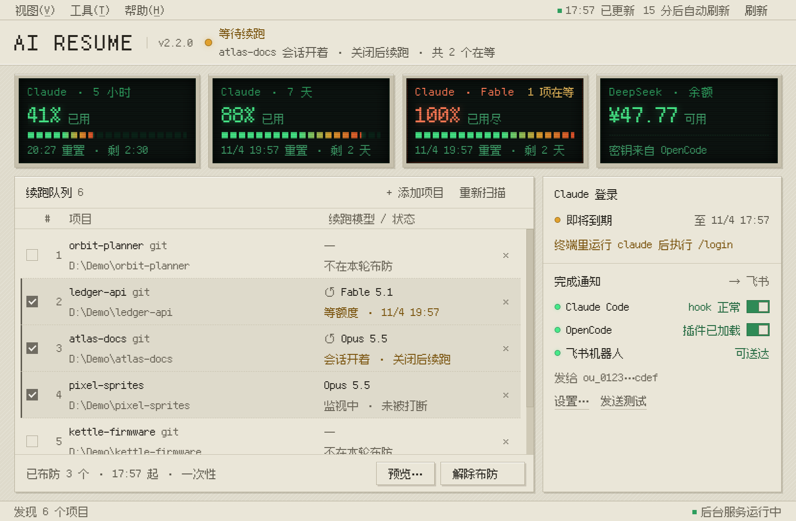

# AI Resume

[English](README.md) | **简体中文**

[](#安装)
[](https://dotnet.microsoft.com/)
[](LICENSE)

> 凌晨两点，AI 撞上额度上限停住了。AI Resume 把活儿排进队列，等额度恢复后自己接着跑，不用你守着。

面向 Claude Code 和 OpenCode 的本地 Windows 控制面：Claude Code 会话被用量上限打断后自动续跑；任务跑完、因错误中断或停下来等你时，给你发一条飞书消息。没有自己的云端后台——界面、队列、状态和钩子全部留在你的机器上，飞书只用来送通知。Codex、Cline、Qoder 的支持仍在，收在**视图**菜单里。



## 它做什么

| | |
|---|---|
| **限额后自动续跑** | Claude Code 会话被用量上限打断后，等额度恢复被证实，再接着跑原来那个会话——逐项目判定、各用各的模型、一次一个。 |
| **自己找项目** | 从 Claude Code 的会话历史里列出项目；也可以手动添加或隐藏目录，不用手工维护清单。 |
| **该打扰你时才打扰** | 任务跑完、因错误中断、停下来等你决定时，各发一条飞书消息——覆盖 Claude Code 和 OpenCode。 |
| **只说能被证伪的话** | 额度、登录、队列和投递——只有真请求或真投递成功过才点绿。 |

## 安装

需要 Windows 10/11、[.NET 10 SDK](https://dotnet.microsoft.com/download)，以及 2.1.139 或更新版本的 [Claude Code](https://claude.com/claude-code)（`claude.exe` 在 `PATH` 上，并已用你的 Claude 账号登录）。飞书通知另需 Node.js 和官方 [lark-cli](https://github.com/larksuite/cli)（`npm i -g @larksuite/cli`，已对 1.0.81 核对）。

```powershell
git clone https://github.com/AquariusCZ/claude-resume.git
cd claude-resume
dotnet build csharp\AiResume.sln -c Release
csharp\src\AiResume.Worker\bin\Release\net10.0-windows\AiResume.Worker.exe install
```

从桌面或开始菜单打开 **AI Resume**，再把右栏两块配好：**Claude 登录**（见 [Claude Code 登录](#claude-code-登录)）和**完成通知 → 飞书**（见[飞书通知设置](#飞书通知设置)）。次要功能收在菜单栏里——**视图** / **工具** / **帮助**（Alt+V/T/H、F10），F5 刷新额度与状态。

`install` 就是部署这一步：真正运行的是 `%LOCALAPPDATA%\AI Resume\` 下的副本而不是 `bin\Release`，所以每次重新构建后都要再跑一次，并重开控制面——已打开的窗口不会热更新。它会暂存并校验产物，等新 Worker 在管道上应答之后才去改任何入口，按你之前开着的通知源重新对齐钩子；回滚不完整时保留恢复材料。退出码 0 表示全部就位；2 表示有通知源没对齐，3 表示新 Worker 没起来（已恢复旧版本），4 表示回滚不完整。它同时装好登录自启，**不会弹控制台窗口**——想再要"挂了自动重启"，见[开机自启](docs/ARCHITECTURE.md#logon-autostart)里那个需要提权一次的计划任务升级（`scripts\register-autostart.ps1`）。

卸载会移除快捷方式和 AI Resume 自己的钩子条目，保留你的设置和数据，包括已保存的飞书机器人凭据：

```powershell
& "$env:LOCALAPPDATA\AI Resume\AiResume.Worker.exe" uninstall
```

可选：OpenCode 2.x，用于它的完成通知和 DeepSeek 余额；Codex CLI，用于 Codex 额度与续跑。

## Claude Code 登录

AI Resume 自己不持有任何 Claude 凭据。它读 Claude Code 自己的登录——`%USERPROFILE%\.claude\.credentials.json`，或 `CLAUDE_CONFIG_DIR` 下的同名文件——来查额度，**只读、绝不刷新、绝不写回**：refresh token 是一次性的，别的进程刷新一次就会把 Claude Code 登出。账号身份取自 Claude Code 全局配置（通常是 `%USERPROFILE%\.claude.json`）里的 `oauthAccount`，不再随访问令牌轮换而漂移。

访问令牌约 8 小时一换，只要 Claude Code 在运行——终端、桌面端或 VS Code 里的会话，或手机远程连接——它就会自己续期；令牌背后的登录约 30 天，只有 `/login` 能续。**Claude 登录**这一栏告诉你现在处在哪一步：

| 界面 | 含义 | 怎么办 |
|---|---|---|
| **有效** | 已登录，访问令牌有效 | — |
| **有效 · 账号未核实** | 还没有一致的 `oauthAccount`，续跑等待 | 打开一次 Claude Code |
| **令牌待续期** | 访问令牌已过期，登录仍有效 | 打开一次 Claude Code，或保持手机远程连接 |
| **即将到期** | 登录 3 天内到期 | 终端里运行 `claude` 后执行 `/login` |
| **已过期** / **未登录** | 登录到期或被清空，或根本没登录 | 终端里运行 `claude` 后执行 `/login` |
| **凭据位置变化** | Claude Code 把登录挪进了 Windows 凭据管理器（`CLAUDE_CODE_FORCE_WINDOWS_CREDMAN=1` 或服务端灰度），AI Resume 读不到 | 额度保持未核实 |

设置了飞书收件人后，Worker 会在登录到期前 3 天、2 天、1 天、12 小时各提醒一次，过期时再提醒一次。访问令牌剩余不足 45 分钟时不启动续跑，该项目等 Claude Code 续期后再说。

v2.1 的 `claude setup-token` 长期令牌已删除：usage 接口不接受它（作用域只覆盖推理），它从来读不到额度。`install` 会删掉残留的 `state\secrets\claude-oauth-token.bin`。

## 飞书通知设置

飞书现在只做一件事：你的机器人经官方 lark-cli 给你发私信。不再有飞书聊天、会话和授权名单。

1. 安装 lark-cli：`npm i -g @larksuite/cli`。AI Resume 直接启动 npm 包里的 `lark-cli.exe`，绝不经 `cmd.exe`——那条路会把多行消息截在第一个换行处。
2. 在飞书开放平台准备一个自建应用：开启机器人能力，并有发消息的权限。收件人（也就是你）要在应用的可用范围内。
3. **工具 › 飞书通知设置…**（或**完成通知 → 飞书**下的**设置…**）：填 App ID（`cli_…`）和 App Secret，点**保存并验证**。AI Resume 先用这组凭据在线跑一次 `lark-cli doctor`，飞书确实换得到机器人令牌才保存。凭据以机器范围 DPAPI 副本存在 `state\secrets\feishu-bot.bin`（只有你、SYSTEM 和 Administrators 可读），投递时经 lark-cli 官方的 `LARKSUITE_CLI_*` 环境变量交给它——后台 Worker 可能跑在会话 0，那里 lark-cli 自己的钥匙串时常读不出来。没有这份副本时退回钥匙串，真实投递成功之前界面显示**未存凭据副本**。从 v2.1 升级？**导入旧版凭据**会把旧版「飞书接入」区保存的凭据经同样的核验后导入。
4. 收件人：粘贴你的 `ou_…` open_id 后点**保存**，或点**识别**从已登录 lark-cli 的用户里挑（`lark-cli auth list`）。open_id 按应用隔离，必须取自机器人所在的那个应用；保存过机器人凭据后，**识别**只列出同一应用的用户。
5. **诊断通道**用投递实际会用的凭据跑 `lark-cli doctor`；**发送测试**（也在**工具 › 发送测试通知**）往队列放一条测试消息，走完整条链路。

**飞书机器人**这一行只有最近一次真实投递成功、且之后没改过设置时才显示**可送达**；后台服务不在时显示**后台服务未运行**；投递受阻时直接写出原因——凭据、权限或收件人、限流、网络；最近一次尝试失败时显示**最近投递失败**；成功之后改过凭据或收件人时显示**设置已变更**（点**发送测试**重新核实）。一条消息失败只按它自己的退避重试，不拖慢别的。通道级故障会让整条通道暂停一段退避时间，你一改凭据或收件人就立即解除。永远发不出去的、发生超过 24 小时还没送出的、或者结果不明已过 55 分钟的消息（飞书只在一小时内去重，再发可能重复）移进 `state\completion-events\dead\`，旁边附一份 `.error.txt`。

## 通知

分三类，因为它们的紧迫程度根本不同。**跑完了**可以晚点看；**中断了**和**在等你**是此刻正在白白流走的时间。

| 来源 | 跑完了 | 因错误中断 | 在等你 |
|---|---|---|---|
| Claude Code | `Stop` hook | `StopFailure`——用量上限（每个会话每个限额周期只提醒一次）、登录失效、账单问题等 | `Notification`——等你授权、MCP 确认框（elicitation）、需要你输入、额度恢复后没能自动接上 |
| OpenCode 2.x | 顶层会话的 `session.execution.succeeded`，且没有仍在运行的子会话 | 顶层会话的 `session.execution.failed`，宽限期内没被自动续跑 | `permission.asked`、`form.created`（AI 提问） |

Claude Code 的钩子以官方 exec form 写进 `%USERPROFILE%\.claude\settings.json`——`command` 是 `AiResume.Hook.exe` 的绝对路径，`args` 放开关——需要 Claude Code 2.1.139 以上。Claude Code 会自己重新加载这个文件，不用新开会话。OpenCode 插件是官方 v2 目录形态，位于 `%USERPROFILE%\.config\opencode\plugins\airesume-notify\index.ts`；旧的单文件插件会被迁移并留一份 `.bak`。直到 OpenCode 自己的日志（`%USERPROFILE%\.local\share\opencode\log\opencode.log`）显示插件已加载，OpenCode 这一行都显示**待核实**；OpenCode 拒绝加载时标红（以日志里最后一条结论为准，之后成功加载会覆盖先前的失败）。一直待核实就重启一次 OpenCode。两处路径都跟随客户端自己的设置：Claude Code 跟随 `CLAUDE_CONFIG_DIR`，OpenCode 跟随 `XDG_CONFIG_HOME` / `XDG_DATA_HOME`。

适配器合并进你已有的配置，且只移除能证明属于自己的条目。AI Resume 自己的续跑运行带内部标记，它们的钩子不会通知你；取而代之的是 AI Resume 自己发的提醒：开始续跑，续跑完成或未确认完成；额度已恢复但会话仍开着；Claude 登录令牌过期；账号已变化；登录即将到期或已过期。经手机远程连接的 Claude Code 会话，通知里会带「· 远程已连接」；Claude Code 的通知还会写上会话名（桌面端侧栏标题或 `/rename`）。用量上限每个会话每个限额周期只提醒一次：同时被打断的会话合成一条，写明哪个额度用完、预计何时重置，并按发出那一刻的布防状态说清 AI Resume 会不会续跑它们。没有落盘的会话（例如第三方工具以 `claude --no-session-persistence` 拉起的进程）不发通知。

Codex（`hooks.json` 里的 `Stop` hook）、Cline（`TaskComplete`）和 Qoder（`hooks.Stop`）仍可用，只发"跑完了"，默认隐藏：**视图 › 显示其他通知源**，或 `notify enable <源>`。隐藏的源若仍开着或 hook 失效，主界面会留一句提示。安装前已经打开的 Codex 会话不会重载 `hooks.json`，请新开会话；若 Codex 里 `/hooks` 显示 AI Resume 的 hook 未信任，在那里信任一次即可。协议与测试步骤见[完成通知](docs/COMPLETION-NOTIFICATIONS.md)。

## 额度与续跑

额度取自 Anthropic 的 OAuth usage 接口，复用 Claude Code 的真实请求形状和 Claude Code 自己的登录。响应是稀疏的，所以缺字段不等于被删除。承接下来的旧值显示为琥珀色的*最近服务端读数*，绝不点绿；只有重置时间没有百分比时用不确定态扫描，而不是编一个数字出来。额度屏含义固定：Claude 5 小时、Claude 7 天、Claude 按模型（已用最高或已满的那条按模型周额度；有布防项目卡在它上面时带「N 项在等」角标）、DeepSeek 余额。余额用 OpenCode 的 DeepSeek 密钥查询（先看 OpenCode 配置，再看 OpenCode 2.x 自己的凭据库 `opencode.db`，然后是旧的 `auth.json`，都没有才用 `DEEPSEEK_API_KEY`），只展示：AI Resume 不保存任何 DeepSeek 密钥，也不用它续跑。OpenCode 合并后的配置把 DeepSeek 指到自定义端点时，不发余额请求。刷新失败而沿用旧读数时，页头写**部分更新**，磁贴悬停说明写出失败原因。

勾选要守护的项目。勾选的行会出现模型下拉：默认的「沿用会话:<模型>」跟随该会话最近实际用的模型（布防后显示为 ↺），也可以逐个改选——多个项目可以共用一个模型，共用的项目共享同一份额度读数。**预览…**只显示每个项目当前的判定，什么都不执行。**布防**会固定本轮的供应商和账号、每个项目从供应商实时目录里选定的模型 ID，以及精确的原生会话；模型目录更新在下次布防采用。会话正开着只给警告；会话模型不在目录里时需要手动选一个。

布防后每个项目各自判定，任何一项核实不了都只等待，绝不放行：

- **被打断了吗？** 会话记录的结尾必须是一次用量上限中断。同一次中断最多续一次；你已经自己续上的会话算完成（「已在客户端继续」）。
- **它的模型额度恢复了吗？** 必须有实时读数显示 5 小时和 7 天窗口都低于 100%，且没有约束该模型的额度被打满。按模型的周额度只约束同一模型族（任何版本都算；认不出模型族的按"有约束"处理），所以 Fable 周额度用尽不再挡住 Opus 项目。
- **会话空着吗？** 会话开在某个客户端里——终端、桌面端、VS Code 或手机远程——或者同目录另一个会话正在跑，这个项目就等。开着的交互会话交给 Claude Code 自己的自动继续；额度恢复 10 分钟后会话仍开着且没有继续，飞书提醒你一次。

项目按队列顺序一次一个续跑，在各自目录里执行 `claude --resume <会话 ID> -p continue --model <模型> …`，每个启动前都重新核验一遍。没能启动的项目——会话刚被打开、访问令牌不足 45 分钟、配置刚变化——本轮跳过、下一轮重试，不再锁死整轮。进程启动后的失败绝不自动重放：本轮停住，等你解除后重新布防。一次性模式（默认）在所有项目都完成后自动解除；**工具 › 连续模式**每次被打断都续跑，下次布防时生效。把鼠标停在某行状态上，可以看到完整原因和预计起续时间。

Codex 默认隐藏，**视图 › 显示 Codex** 之后才出现它的额度屏，并可选为续跑供应商。它使用 `~/.codex/auth.json` 里的官方 ChatGPT/OpenAI 登录——Codex 里配置的本机中转不会被使用。Codex 没有会话记录核对：观测到项目的模型受限时排进队列，账号各窗口都低于 100%、没有附加限额或消费上限命中、目标模型未被标为不可用时才续跑。其它已配置的供应商（非本机的第三方 Codex provider，或指向 API 端点的 Claude Code）需要已核实的正余额。没有额度数据就显示“未核实”；不会自动换供应商；固定模型 ID 不等于冻结供应商同名 ID 的后端版本。详见[供应商与固定目标续跑](docs/adr/0004-provider-bound-resume.md)和 [ADR-0006](docs/adr/0006-retire-cc-connect-per-project-resume.md)。

## 用手机远程

AI Resume 不再带飞书聊天机器人：cc-connect 已在 v2.2 退役（[ADR-0006](docs/adr/0006-retire-cc-connect-per-project-resume.md)），飞书只送通知。想在手机上继续干活，请用 Claude Code 官方的 [Remote Control](https://code.claude.com/docs/en/remote-control)（`claude remote-control`）；它需要 Claude 订阅登录，本机的 `claude` 进程也得一直开着。会话仍在这台机器上跑，所以钩子照常触发。远程会话开着时，AI Resume 把它当成普通的打开中会话，不会在它底下续跑——而 Claude Code 不会在用量上限后自动继续远程会话，所以上面那条"10 分钟后提醒"就是你该在手机上接着干的信号。

用手机驱动 OpenCode 或 Codex 的能力随之放弃。确实需要时可以自己运行 cc-connect；AI Resume 不再生成、启动或检查它的配置。

## 结构

```text
Claude Code / OpenCode          （Codex · Cline · Qoder 默认隐藏）
       |  钩子 / 插件
       v
 AiResume.Hook ----------> state\completion-events\
                                     |
                                     v
AiResume.Gui <--- 共享状态目录 --> AiResume.Worker ----> lark-cli ----> 飞书机器人私信
   WPF + WebView2                  续跑引擎、额度、
                                   通知投递、登录提醒、
                                   进程监督
                                     |
                                     v
                      claude --resume <会话>（一次一个项目）
```

```text
%LOCALAPPDATA%\AI Resume\          安装副本：Gui、Worker、Hook、Launcher
  state\                           卸载时保留
    config.json                    队列、布防、逐项目模型、通知源、收件人 open_id
    runs.db                        SQLite/WAL：续跑周期、进程登记、额度快照
    project-index.json             项目发现缓存
    secrets\feishu-bot.bin         飞书机器人凭据（机器范围 DPAPI）
    completion-events\             通知队列；dead\ 存放发不出去的消息
    completion-notify-*.json       去重、逐条重试状态、通道健康
    logs\                          按日滚动的 JSON 日志，如 worker-yyyyMMdd.log
    webview2\                      WebView2 用户数据
```

代码给自己定的硬规矩：

- **绿色代表已验证。** CLI 装着、key 填了、钩子写进去了都不算证据——必须有一次请求或投递真的成功过。
- **未知就等待。** 任何一项核实不了，都只让那个项目等着，绝不算放行。
- **别人的登录只读。** Claude Code 的登录、Codex 的 `auth.json`、OpenCode 的 DeepSeek 密钥只读，绝不刷新、绝不写回。
- **不靠 PID 杀进程。** 身份、启动时间和命令签名全部对上才允许回收。

## 命令

从安装副本运行，这样写进配置的钩子路径才会指向安装目录：

```powershell
$w = "$env:LOCALAPPDATA\AI Resume\AiResume.Worker.exe"
& $w notify check
```

| 命令 | 作用 | 退出码 |
|---|---|---|
| `install` | 部署、重建入口、按意图对齐通知源 | 0 成功 · 1 出错 · 2 通知源未对齐 · 3 Worker 未起来 · 4 回滚不完整 |
| `uninstall` | 移除安装副本、快捷方式和自己的钩子条目；保留 `state\` | |
| `shortcuts` | 重建桌面、开始菜单和开机自启入口（`shortcuts uninstall` 移除）；`install` 会替你做 | |
| `notify` · `notify list` | 每个通知源：已安装、已启用、可送达 | 有已启用的源 hook 失效时为 2 |
| `notify enable <源>` · `notify disable <源>` | 开关 `ClaudeCode`、`OpenCode`、`Codex`、`Cline`、`Qoder`，并记住意图供下次安装恢复 | 失败为 1 |
| `notify check` | lark-cli、凭据来源、收件人、最近一次真实投递，再跑 `lark-cli doctor` | 0 就绪 · 2 未就绪 |
| `notify test` | 往队列放一条测试消息，最多等 90 秒看 Worker 是否送达 | 0 已送达 · 2 未送达 |

不带子命令运行时，Worker 以常驻服务启动，开机自启入口就是这样拉起它的；未知子命令会打印命令列表并返回 2。

## 真机验证

`install` 之后：

1. `& $w notify list`——每个已启用的源「可送达」都是 True，退出码 0。OpenCode 那一行的说明应是 `OpenCode 已加载(日志 …)`，而不是 `等 OpenCode 下次加载后核实`。
2. `& $w notify check`——最后一行是 `结论: 飞书通知通道就绪`，退出码 0。
3. `& $w notify test`——90 秒内退出码 0，手机上收到「🧪 AI Resume 测试通知」。退出码 2 时会说明原因：飞书投递暂停的原因及其错误码和 `log_id`，或 90 秒内没有送达——这时确认后台服务（Worker）在运行，再跑 `notify check`。
4. 控制面页脚显示「后台服务运行中」，**Claude 登录**显示**有效**，**飞书机器人**显示**可送达**。
5. 每次续跑判定都逐项目记进 `state\logs\worker-yyyyMMdd.log` 的 `resume.probe.evaluated`（`name=model|quota|session|evidence|reason`）。

2.2.0 待真机验证的事项（截至 2026-10-30）：一次真实用量上限中断后的逐项目自动续跑；OpenCode 2.x 真实加载新插件并发出通知；保存或导入机器人凭据后，会话 0 的 Worker 经机器范围凭据真实投递；登录到期提醒。

## 从 v2.1 升级

- 用新构建跑一次 `install`。它会把 Claude Code 钩子改写成带 `StopFailure` 的 exec form，把已启用的 OpenCode 通知迁到 2.x 目录插件，并删掉不再使用的 `claude-oauth-token.bin`。
- 打开**飞书通知设置**：点**导入旧版凭据**，或重新填写机器人凭据。`config.json` 里已有的收件人会沿用。
- 解除布防后重新布防。Claude 账号身份现在取自 Claude Code 的账号记录，而不是会轮换的访问令牌，所以 v2.1 的布防对不上了（被打断的项目会显示「账号已变化 · 重新布防」）；重新布防也会给每个项目固定模型。
- AI Resume 不再管理 cc-connect，它的计划任务、npm 包和 `%USERPROFILE%\.cc-connect\` 都原样不动。不用了就自己删掉——那个目录里有明文密钥，记得一并吊销更换。
- Codex、Cline、Qoder 的通知开关挪到了**视图 › 显示其他通知源**；原来开着的仍然开着。
- DeepSeek 余额屏现在显示 OpenCode 那把密钥对应的账户；`DEEPSEEK_API_KEY` 只是兜底。

## 开发

```powershell
dotnet test csharp\AiResume.sln
dotnet build csharp\AiResume.sln -c Release --no-restore -warnaserror
```

测试使用临时状态、合成会话和注入的 runner，绝不续跑真实会话、不改真实项目、不发付费模型请求。测试需要 `PATH` 上有 Node.js：控制面的视图模型和 OpenCode 插件都在 Node 里驱动。`AiResume.Gui.exe --screenshot <png>` 用合成数据渲染控制面（加 `--screenshot-unarmed` 得到未布防态）；先把 `AIRESUME_SHADOW_DIR` 指向一个临时目录，免得碰到你真实的状态目录。

## 文档

[架构](docs/ARCHITECTURE.md) · [额度获取](docs/CLAUDE-QUOTA-ACQUISITION.md) · [通知协议](docs/COMPLETION-NOTIFICATIONS.md) · [运行契约](docs/RUN-CONTRACT.md) · [决策记录（ADR）](docs/adr/) · [v2.2 决策（ADR-0006）](docs/adr/0006-retire-cc-connect-per-project-resume.md) · [工程教训](docs/LESSONS.md) · [AI 导览](AI_GUIDE.md) · [历史资料](docs/history/)

## 许可

MIT，见 [LICENSE](LICENSE)。界面使用[方舟像素字体](https://github.com/TakWolf/ark-pixel-font)，遵循 SIL OFL 1.1（[OFL.txt](csharp/src/AiResume.Gui/wwwroot/fonts/OFL.txt)）。
