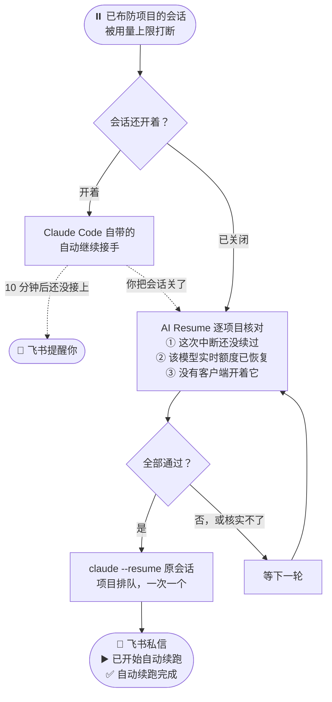

<div align="center">

# AI Resume

**Claude Code 撞上用量上限，你可以先去睡了。**

额度一恢复，AI Resume 就把你已经关掉的会话接着跑下去；<br>
任务跑完、出错或者等你拍板时，飞书私信告诉你。

[](#系统要求)
[](https://dotnet.microsoft.com/)
[](csharp/Directory.Build.props)
[](LICENSE)

[English](README.md) · **简体中文**

</div>


<p align="center"><sub>演示数据：三个项目已布防，一个在等 Fable 周额度，一个会话还开着、关掉后才续，一个没被打断、只是监视着。右栏的琥珀色是如实相告：Claude 登录 3 天内到期，飞书投递暂时核对不了，所以写「待核实」。</sub></p>

## 为什么需要它

Claude Code 自带的自动继续（`autoContinueAtUsageLimit`，2.1.234 起默认开启，桌面端另有自己的开关）只照顾**还开着**的交互会话。会话一关，进程退出，等待也就跟着没了；手机上的 Remote Control 会话（界面和消息里叫「手机远程」）、要等一天以上才重置的周额度，它也不会替你等。夜里跑长任务撞了限，第二天早上看到的往往是一个停在半路的会话。

AI Resume 补的就是这一块。两边各管一摊，互不抢活：

| 场景 | Claude Code 自带的自动继续 | AI Resume（已布防的项目） |
|---|---|---|
| 会话还开着（终端、桌面端、VS Code） | 原地等，重置后自动接上 | 不插手；额度恢复 10 分钟后还没接上，飞书提醒你一次 |
| 会话已经关掉 | 不管（进程退出，等待随之结束） | 额度真的恢复后，用 `claude --resume` 把原会话接着跑 |
| 手机上的 Remote Control 会话 | 不自动等 | 开着时同样不插手；额度恢复 10 分钟后还没接上，提醒你在手机上继续 |
| 周额度要等一天以上才重置 | 不自动等 | 关掉的会话照样等到恢复再续 |

> [!NOTE]
> 过夜无人值守有两个前提。一是电脑不能睡眠：AI Resume 跑在本机，睡着时什么也做不了。二是登录令牌得有人续期：AI Resume 从不刷新令牌，访问令牌约 8 小时过期，只有运行中的 Claude Code 会续期。Claude Code 全关掉的话，令牌一过期，续跑就会一直等到你再打开它；想稳妥，就留一个 Claude Code 进程开着，比如在别的目录开一个 `claude remote-control`。

## 它能做什么

### 限额后自动续跑

- **看真实额度，不靠定时器瞎试。** 读数来自 Anthropic 官方的 OAuth usage 接口，用的是 Claude Code 自己的登录；只有本次实时读数显示额度窗口没满，才会放行。
- **逐项目判定，各用各的模型。** 每个项目只看和它的模型相关的额度：Fable 周额度用完，不会挡住用 Opus 的项目。
- **续的是原会话。** 执行 `claude --resume <会话 ID>`，上下文原样保留，不新开会话，也不改写会话记录；同一次中断最多续一次。
- **核实不了就等，绝不硬闯。** 会话刚被打开、令牌快过期、配置刚改过，这个项目就等下一轮；续跑进程起来以后出了问题，这一轮就停住等你检查，不会再自动续跑。

### 飞书私信：跑完、出错、等你，都会告诉你

- 覆盖 Claude Code 和 OpenCode 的三类事件：跑完了、因错误中断、停下来等你（授权、确认、输入）。
- 撞上用量上限时，同一个会话在一个限额周期里只提醒一次；同时被打断的几个会话合成一条，并按发出那一刻的布防状态说清 AI Resume 会不会续跑它们。
- 经官方 lark-cli 用你自己的飞书机器人发送。单条失败只推迟这一条；凭据失效、断网、被飞书限流这类影响所有消息的问题，会让飞书投递暂停一阵，之后自动重试。

收到的消息长这样（合成示例）：

```text
⏸️ atlas-docs 被用量上限打断
Claude Code · Opus 5.5 · 02:14 · 「迁移文档站」
5 小时额度已用完,预计 04:30 重置
已布防:额度恢复后 AI Resume 会续跑它;会话还开着的话 AI Resume 不插手,关掉后才续
```

等额度恢复、会话也关掉，还会陆续收到「▶️ atlas-docs 已开始自动续跑」和「✅ atlas-docs 自动续跑完成」。

### 一个说实话的控制面

- **额度磁贴**：Claude 5 小时、7 天、按模型的周额度，以及 OpenCode 所用 DeepSeek 账户的余额。
- **续跑队列**：自动从 Claude Code 的会话历史里发现项目，不用手工维护清单；也可以「+ 添加项目」，或把不想看到的目录放进「不再扫描的目录」。每个项目用哪个模型、此刻在等什么，一眼看清；「预览…」只看判定，什么都不执行。
- **Claude 登录**：登录还剩几天到期；到期前 3 天起，飞书提醒你 `/login`。
- **绿灯必须有证据**：CLI 装了、key 填了都不算数，供应商要有一次真实请求成功，飞书要有一次真实送达；「hook 正常」也要核对 hook 指向的程序确实存在。核对不出来的一律写「未核实」或「待核实」，绝不显示「没问题」。

## 工作原理



完成通知走另一条路：Claude Code 的 hook 和 OpenCode 的插件把事件写进本地队列，后台服务再经 lark-cli 发到你的飞书。界面、队列和状态都留在你自己的电脑上，AI Resume 没有云端服务。机制细节见[架构文档](docs/ARCHITECTURE.md)。

## 系统要求

| 需要 | 说明 |
|---|---|
| Windows 10 / 11 | 界面基于 WebView2：Windows 11 自带；Windows 10 若没有，装一下 [WebView2 运行时](https://developer.microsoft.com/microsoft-edge/webview2/) |
| [.NET 10 SDK](https://dotnet.microsoft.com/download) | 目前从源码构建 |
| [Claude Code](https://claude.com/claude-code) 2.1.139 或更新 | `claude.exe` 在 `PATH` 上，并已用你的 Claude 账号登录 |
| Node.js 与官方 [lark-cli](https://github.com/larksuite/cli) | 飞书通知用：`npm i -g @larksuite/cli`（已对 1.0.81 核对），另需一个启用了机器人的飞书自建应用。目前只支持飞书，不支持 Lark 国际版 |

可选：OpenCode 2.x，用于它的完成通知和 DeepSeek 余额；Codex CLI，用于 Codex 额度与续跑（默认隐藏）。

## 安装

```powershell
git clone https://github.com/AquariusCZ/claude-resume.git
cd claude-resume
dotnet build csharp\AiResume.sln -c Release
csharp\src\AiResume.Worker\bin\Release\net10.0-windows\AiResume.Worker.exe install
```

`install` 把程序部署到 `%LOCALAPPDATA%\AI Resume\`，建好桌面、开始菜单和开机自启入口（自启不弹控制台窗口），并把你之前开过的通知源重新指向安装目录；首次安装不会替你打开任何通知源，见下面的快速上手。退出码 0 才表示全部就位：2 表示有通知源没接好，3 表示新的后台服务没起来（已恢复旧版本），4 表示回滚不完整（恢复材料会留在原处，先别删）。

真正运行的是安装目录里的副本：以后每次重新构建都要再跑一次 `install`，并关掉旧窗口重开。

想让后台服务挂了能自动重启，可以把开机自启改成计划任务：在管理员 PowerShell 里于仓库根目录运行 `powershell -ExecutionPolicy Bypass -File .\scripts\register-autostart.ps1`，加 `-Revert` 可以改回去（见[开机自启说明](docs/ARCHITECTURE.md#logon-autostart)）。已知问题：这样运行时后台服务在会话 0，界面暂时连不上它，页脚和「飞书机器人」一行会显示「未核实」，投递和续跑不受影响。

卸载会移除程序、快捷方式和 AI Resume 自己的 hook 条目；`%LOCALAPPDATA%\AI Resume\state\` 里的设置、运行记录和飞书机器人凭据都会保留，重装后接着用。注册过计划任务的话，先用 `-Revert` 把它撤掉。

```powershell
& "$env:LOCALAPPDATA\AI Resume\AiResume.Worker.exe" uninstall
```

## 快速上手

1. **确认 Claude 登录。** 从桌面或开始菜单打开 **AI Resume**，右栏「Claude 登录」显示「有效」就行。它读的是 Claude Code 自己的登录，你什么都不用填。
2. **打开通知源。** 在右栏「完成通知 → 飞书」里打开 Claude Code 的开关（用 OpenCode 的话也打开），等它显示「hook 正常」。OpenCode 显示的是「插件已加载」，一直「待核实」的话，重启一次 OpenCode。
3. **接上飞书**（可选，但很值得）：
   - 在飞书开放平台建一个自建应用，开启机器人能力和发消息权限，发布应用版本、让机器人处于启用状态，并确认你自己在应用的可用范围内。
   - 打开「工具 › 飞书通知设置…」，填 App ID（`cli_…`）和 App Secret，点「保存并验证」。
   - 收件人：点「识别」从已登录 lark-cli 的用户里挑自己（列表是空的，就先用这个应用运行一次 `lark-cli auth login`），或者粘贴你的 `ou_…` open_id 后点「保存」。open_id 按应用区分，必须取自这个机器人所在的应用。
   - 关掉对话框，点右栏的「发送测试」，手机上应该收到「🧪 AI Resume 测试通知」。没收到就回对话框点「诊断通道」，或者运行下面的 `notify check`。
4. **布防**，也就是把项目交给 AI Resume 守着。在续跑队列里勾选要守护的项目，每个项目默认「沿用会话」最近用的模型，也可以单独换。先点「预览…」看看每个项目现在的判定，再点「布防」。布防会把每个项目绑定到它此刻最近的那个会话，所以先开始干活再布防；之后在同一项目里新开的会话，要解除后重新布防才算数。默认是一次性的：所有项目都续完就自动解除；想每次被打断都续，打开「工具 › 连续模式」（下次布防时生效）。

装好后想核对一遍，可以跑这三条：

```powershell
$w = "$env:LOCALAPPDATA\AI Resume\AiResume.Worker.exe"
& $w notify list    # 打开过的通知源「已启用」「可送达」都是 True，退出码 0
& $w notify check   # 最后一行是「结论: 飞书通知通道就绪」
& $w notify test    # 90 秒内真实送达，退出码 0
```

控制面页脚显示「后台服务运行中」，「Claude 登录」显示「有效」，Claude Code 一行显示「hook 正常」，「飞书机器人」显示「可送达」，就说明一切就位。

## 安全与隐私

- **不会把你登出。** AI Resume 自己不存任何 Claude 凭据，只读 Claude Code 的登录文件（`%USERPROFILE%\.claude\.credentials.json`，或 `CLAUDE_CONFIG_DIR` 下的同名文件），**绝不刷新、绝不写回 OAuth 令牌**。刷新令牌（refresh token）只能用一次，任何外部程序刷新一次，Claude Code 就会被登出。令牌由正在运行的 Claude Code 自己轮换；登录约 30 天到期，只有你自己 `/login` 能续。
- **其他工具的凭据一律只读。** Codex 的 `auth.json`、OpenCode 的 DeepSeek 密钥同样只读不写；AI Resume 不保存任何 DeepSeek 密钥。
- **飞书机器人凭据：核验过才存，存了就锁紧。** App ID 和 App Secret 只能从「飞书通知设置」录入。保存前，AI Resume 先向飞书真实换一次 tenant_access_token，再用这个令牌经 lark-cli 调通一次机器人信息接口，两步都过才用 Windows DPAPI（机器范围）加密成 `state\secrets\feishu-bot.bin`；文件只允许你本人、SYSTEM 和 Administrators 访问，做不到就不保存。机器范围加密意味着本机管理员也能解开它。投递时 App Secret 只出现在发给飞书换令牌接口的请求里，lark-cli 拿到的只是 App ID 和短期令牌，令牌只留在内存；凭据不进命令行参数、日志、界面或截图，界面只显示遮蔽后的 App ID。卸载会保留这份凭据，要删掉就在「飞书通知设置」里点「清除凭据」。
- **没有云端服务，没有遥测。** 对外请求只有三类：用本机各客户端已有的凭据查询额度和模型目录（Anthropic，以及你给 Claude Code 配置的 API 端点；装了 Codex、OpenCode 时还有对应的 OpenAI、DeepSeek 和 Codex 里配置的第三方供应商）；向飞书官方接口换取机器人令牌；经 lark-cli 发送飞书消息、诊断通道。面板刷新不调用任何模型，一个 token 都不花。令牌和凭据不进日志，通知日志也不记消息正文。

## 常见问题

<details>
<summary><b>Claude Code 自己不是会自动继续吗？</b></summary>

会，但只管还开着的交互会话，Remote Control 会话和要等一天以上才重置的周额度它也不等。AI Resume 只续已经关掉的会话；开着的会话（包括 Remote Control）它一律不插手，项目已布防的话，额度恢复 10 分钟后还没接上就飞书提醒你，你可以就地继续，也可以关掉会话交给它。见上面的[分工表](#为什么需要它)。

</details>

<details>
<summary><b>会不会把我的 Claude Code 登出？</b></summary>

不会。AI Resume 只读 Claude Code 的登录文件，从不刷新，也从不写回令牌。

</details>

<details>
<summary><b>续跑会不会偷偷花掉我的额度？</b></summary>

续跑就是用你的订阅把原来那个会话接着跑下去，和你自己回来输入 `continue` 一样耗额度；同一次中断最多续一次。除此之外 AI Resume 不调用任何模型：面板刷新只读额度和模型目录接口，零 token。

</details>

<details>
<summary><b>续跑失败了会怎样？</b></summary>

分两种。还没启动就被拦下的（会话刚被打开、令牌快过期、配置刚改过），只跳过这一轮，下一轮重新判定；续跑进程起来以后出了问题，这一轮就停住，不会再自动续跑，等你检查后解除并重新布防。刚续上又撞了限，这个项目回到等待，不会一直占着队列。

</details>

<details>
<summary><b>续跑时遇到要批准的操作怎么办？</b></summary>

没人能批。续跑在后台无人值守地运行（`claude -p`），权限按你自己的 Claude Code 设置，AI Resume 既不提权也不降权，需要当场点批准的操作没法批准。要长时间无人值守，事先在 Claude Code 的权限设置里放行它需要的操作。跑完后打开原会话，就能看到它做了什么。

</details>

<details>
<summary><b>不用飞书可以吗？</b></summary>

可以。续跑不依赖飞书；不配飞书只是收不到完成通知、续跑提醒和登录到期提醒。

</details>

<details>
<summary><b>人不在电脑前，怎么在手机上接着干？</b></summary>

用 Claude Code 官方的 [Remote Control](https://code.claude.com/docs/en/remote-control)（`claude remote-control`）。它需要 Claude 订阅登录，本机的 `claude` 进程也要一直开着，这个进程还会顺带续期登录令牌。会话仍跑在这台电脑上，所以 hook 照常触发、通知照常发。Remote Control 会话开着时 AI Resume 不插手，Claude Code 也不会在撞限后自动继续它；项目已布防的话，额度恢复 10 分钟后那条飞书提醒，就是你该在手机上接着干的信号。AI Resume 自己不做聊天机器人。

</details>

<details>
<summary><b>支持 Codex、OpenCode、Cline、Qoder 吗？</b></summary>

- **OpenCode 2.x**：完成通知，外加它所用 DeepSeek 账户的余额（只展示，不参与续跑）。
- **Codex**：默认隐藏，打开「视图 › 显示 Codex」后出现额度磁贴，也可选为续跑供应商。它用 `%USERPROFILE%\.codex\auth.json` 里的官方 ChatGPT/OpenAI 登录；续跑要求本机 Codex 恰好是 0.148.0，而且 Codex 配置目录里有 `managed_config.toml`，布防时就会检查。Codex 的会话记录里没有结构化的限流证据，所以观测到模型受限才排队，账号各窗口都低于 100% 才续。
- **Codex、Cline、Qoder 的完成通知**：只发「跑完了」，默认隐藏，在「视图 › 显示其他通知源」里打开。Codex 的 hook 要在 Codex 里用 `/hooks` 信任一次，新开的会话才生效。
- 额度核实不了就等着，绝不自动换供应商重跑。

</details>

<details>
<summary><b>能在 macOS 或 Linux 上用吗？</b></summary>

不能。它依赖 WPF + WebView2 界面、Windows DPAPI 和计划任务，只支持 Windows 10/11。

</details>

<details>
<summary><b>界面上为什么常有「未核实」「待核实」？</b></summary>

这是故意的。每一个「正常」「可送达」这样的肯定结论，都要有外部证据：额度要有本次的实时读数；「可送达」要有最近一次真实送达，而且之后没改过设置；「hook 正常」要核对 hook 指向的程序确实存在；OpenCode 的「插件已加载」只认 OpenCode 自己的日志。核对不出来就如实说，绝不凭印象点绿。

</details>

<details>
<summary><b>现在稳定吗？</b></summary>

核心判定由全仓 1300 多项自动化测试覆盖，全部用合成会话和临时目录，绝不碰真实会话。安装和飞书投递已在作者本机真机走通，包括以计划任务在会话 0 运行的后台服务。还在等真实事件验证的有三项：一次真实撞限后的端到端自动续跑、OpenCode 里真实任务的完成通知、Claude Code 登录到期提醒。验证记录见[完成通知 · 验证层级](docs/COMPLETION-NOTIFICATIONS.md#6-验证层级)。

</details>

## 参考

<details>
<summary><b>Claude 登录的几种状态</b></summary>

访问令牌约 8 小时一换，只要 Claude Code 在运行（终端、桌面端、VS Code，或手机 Remote Control 连着），它就会自己续期；令牌背后的登录约 30 天，只有 `/login` 能续。访问令牌剩余不足 45 分钟时不启动续跑，这个项目会等 Claude Code 续期后再说。

| 界面 | 含义 | 怎么办 |
|---|---|---|
| 有效 | 已登录，访问令牌有效 | — |
| 有效 · 账号未核实 | 还读不到一致的账号信息，续跑等待 | 打开一次 Claude Code，让它写入账号信息 |
| 令牌待续期 | 访问令牌过期，登录仍有效 | 打开一次 Claude Code，或保持 Remote Control 连着 |
| 即将到期 | 登录 3 天内到期 | 终端里运行 `claude` 后执行 `/login` |
| 已过期 / 未登录 | 登录到期、被清空，或根本没登录 | 终端里运行 `claude` 后执行 `/login` |
| 被服务端拒绝 | 额度接口拒绝了本机的登录（改过密码、被移出组织或在别处登出） | 终端里运行 `claude` 后执行 `/login` |
| 凭据位置变化 | Claude Code 把登录挪进了 Windows 凭据管理器，AI Resume 读不到 | 额度保持未核实，续跑一直等待 |
| 未核实 | 登录文件在，但这次没读出来（多半正被 Claude Code 改写） | 不用管，稍后自动重读 |

设置了飞书收件人后，后台服务会在登录到期前 3 天、2 天、1 天、12 小时各提醒一次，过期时再提醒一次；登录被 Claude Code 清空的话，每天提醒一次，直到恢复。

</details>

<details>
<summary><b>什么时候会续跑</b></summary>

布防后，每个项目各自判定，任何一项核实不了都只等待、绝不放行：

- **被打断了吗？** 会话记录的结尾必须是一次用量上限中断，而且这次中断还没续过。你已经自己在客户端里接着干了的，算完成（「已在客户端继续」）。
- **它的模型额度恢复了吗？** 本次实时读数要显示 5 小时和 7 天窗口都低于 100%，而且约束这个模型的周额度没满。按模型的周额度只约束同一模型族（认不出模型族的按「有约束」处理）。
- **会话空着吗？** 会话开在任何客户端里（终端、桌面端、VS Code 或 Remote Control），或者同目录另一个会话正在跑，这个项目就等。

项目按队列顺序一次一个续跑，在各自目录里执行 `claude --resume <会话 ID> -p continue --model <模型> …`，每个启动前都重新核对一遍。共用同一模型的项目共享一份额度读数。把鼠标停在某一行的状态上，能看到完整原因和预计几点开始续跑。完整规则见[架构 · 额度与续跑流程](docs/ARCHITECTURE.md#额度与续跑流程)。

</details>

<details>
<summary><b>会通知哪些事件</b></summary>

| 来源 | 跑完了 | 因错误中断 | 在等你 |
|---|---|---|---|
| Claude Code | `Stop` hook | `StopFailure`：用量上限（每个会话每个限额周期一次）、登录失效、账单问题等 | `Notification`：等你授权、MCP 确认框、需要你输入、额度恢复后没能自动接上 |
| OpenCode 2.x | 顶层会话执行成功，且没有仍在运行的子会话 | 顶层会话执行失败，宽限期内没被自动重试 | 等你授权、AI 向你提问 |

AI Resume 自己的续跑运行带内部标记，不会触发上面这些通知；它另外发自己的提醒：开始续跑，续跑完成、未确认完成或已中止，一直没能开始续跑，额度已恢复但会话还开着，读不到额度（令牌过期、登录失效等），账号变了，登录即将到期或已过期。经 Remote Control 连着的会话，消息里会带「· 远程已连接」。没有保存会话记录的会话（例如第三方工具用 `claude --no-session-persistence` 拉起的进程）不发通知。

Claude Code 的 hook 以官方 exec form 写进 `%USERPROFILE%\.claude\settings.json`，Claude Code 会自己重新加载，不用新开会话；OpenCode 插件放在 `%USERPROFILE%\.config\opencode\plugins\airesume-notify\`。两处都跟随客户端自己的配置目录设置（`CLAUDE_CONFIG_DIR`、`XDG_CONFIG_HOME`），只增删 AI Resume 自己的条目。右栏的「未送达 N」是已经停止重试的消息，原因写在 `state\completion-events\dead\` 里同名的 `.error.txt` 中。协议与验证见[完成通知](docs/COMPLETION-NOTIFICATIONS.md)。

</details>

<details>
<summary><b>命令行</b></summary>

从安装副本运行，写进配置的 hook 路径才会指向安装目录：

```powershell
$w = "$env:LOCALAPPDATA\AI Resume\AiResume.Worker.exe"
& $w notify check
```

| 命令 | 作用 | 退出码 |
|---|---|---|
| `install` | 部署、重建入口、按记住的意图对齐通知源 | 0 成功 · 1 出错 · 2 通知源未对齐 · 3 后台服务没起来 · 4 回滚不完整 |
| `uninstall` | 移除安装副本、快捷方式和自己的 hook 条目；保留 `state\` | |
| `shortcuts` | 重建桌面、开始菜单和开机自启入口（`shortcuts uninstall` 移除）；`install` 会替你做 | |
| `notify` · `notify list` | 每个通知源：已安装、已启用、可送达 | 有已启用的源 hook 失效时为 2 |
| `notify enable <源>` · `notify disable <源>` | 开关 `ClaudeCode`、`OpenCode`、`Codex`、`Cline`、`Qoder`，并记住意图供下次安装恢复 | 失败为 1 |
| `notify check` | 检查 lark-cli、凭据来源、收件人和最近一次真实投递，再在线诊断：有凭据副本时先真实换令牌、调一次机器人接口，再附 `lark-cli doctor` | 0 就绪 · 2 未就绪 |
| `notify test` | 往队列放一条测试通知，最多等 90 秒看后台服务是否真实送达 | 0 已送达 · 2 未送达 |

不带子命令运行时，`AiResume.Worker.exe` 以后台服务方式常驻，开机自启入口就是这样拉起它的；未知子命令会打印命令列表并返回 2。每次续跑判定都逐项目记在 `state\logs\worker-yyyyMMdd.log` 的 `resume.probe.evaluated` 里。

</details>

<details>
<summary><b>从 v2.1 升级</b></summary>

- 用新构建跑一次 `install`。它会把 Claude Code 的 hook 改写成带 `StopFailure` 的 exec form，把已启用的 OpenCode 通知迁到 2.x 目录插件，并删掉不再使用的 `claude-oauth-token.bin`。
- 打开「飞书通知设置」，点「导入旧版凭据」，或者重新填写机器人凭据。`config.json` 里已有的收件人会沿用。
- 解除布防后重新布防。Claude 账号身份现在取自 Claude Code 的账号记录，不再取自会轮换的访问令牌，所以 v2.1 的布防对不上了（被打断的项目会显示「账号已变化 · 重新布防」）；重新布防也会给每个项目固定模型。
- AI Resume 不再管理 cc-connect，它的计划任务、npm 包和 `%USERPROFILE%\.cc-connect\` 都原样不动。不用了就自己删掉：那个目录里有明文密钥，记得一并吊销更换。
- Codex、Cline、Qoder 的通知开关挪到了「视图 › 显示其他通知源」，原来开着的仍然开着。
- DeepSeek 余额磁贴现在显示 OpenCode 那把密钥对应的账户；`DEEPSEEK_API_KEY` 只在 OpenCode 那边找不到密钥时兜底。

</details>

## 开发

```powershell
dotnet test csharp\AiResume.sln
dotnet build csharp\AiResume.sln -c Release --no-restore -warnaserror
```

测试只用临时状态、合成会话和注入的运行器：绝不续跑真实会话、不改真实项目、不发付费模型请求。部分用例要用 `PATH` 上的 Node.js 驱动界面的视图模型和 OpenCode 插件。`AiResume.Gui.exe --screenshot <png>` 用合成数据离屏渲染控制面（加 `--screenshot-unarmed` 得到未布防态），运行前先把 `AIRESUME_SHADOW_DIR` 指向一个临时目录，免得碰到真实的状态目录。

## 文档

[架构](docs/ARCHITECTURE.md) · [额度获取](docs/CLAUDE-QUOTA-ACQUISITION.md) · [完成通知](docs/COMPLETION-NOTIFICATIONS.md) · [运行契约](docs/RUN-CONTRACT.md) · [决策记录（ADR）](docs/adr/) · [工程教训](docs/LESSONS.md) · [AI 导览](AI_GUIDE.md) · [历史资料](docs/history/)

## 许可

MIT，见 [LICENSE](LICENSE)。界面使用[方舟像素字体](https://github.com/TakWolf/ark-pixel-font)，遵循 SIL OFL 1.1（[OFL.txt](csharp/src/AiResume.Gui/wwwroot/fonts/OFL.txt)）。
